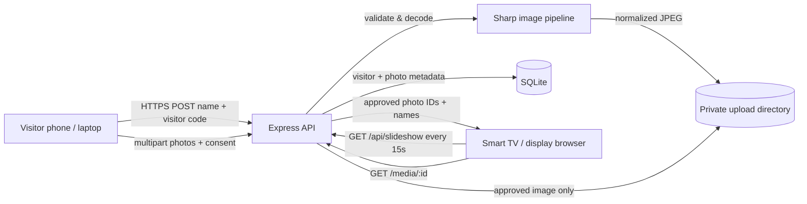
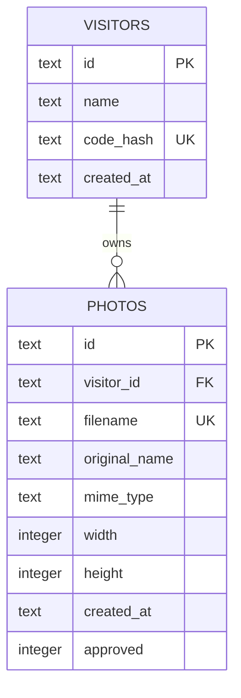

# Architecture

## Stack choice

- **Node.js + Express:** one small HTTP service for visitor registration, uploads, slideshow reads and deletion.
- **SQLite (`better-sqlite3`):** relational metadata and foreign-key cascade for a single-instance venue deployment. WAL mode supports concurrent readers while writes remain serialized.
- **Multer + Sharp:** bounded multipart intake followed by actual image decoding, dimension checks, orientation correction, resizing and re-encoding. MIME headers alone are not trusted.
- **Vanilla browser UI:** minimal runtime and no build step; visitor form and display can run on separate devices.

## System diagram

## Data model

- A visitor is a profile identified by a UUID plus a hash of a random 10-character visitor code.
- A photo belongs to exactly one visitor. Deleting a visitor cascades its photo metadata; the route also removes the corresponding files.
- The public slideshow query returns only approved photos, in stable oldest-first order, with the visitor display name and a media URL.

## Request flows

1. **First visit:** `POST /api/visitors` with a name and no code. Server creates a UUID, generates a recovery code, stores only its SHA-256 hash and returns the code once.
2. **Returning visit:** same endpoint with name + code. Server hashes the code, finds the profile and checks the name; no duplicate profile is created.
3. **Upload:** `POST /api/photos` with visitor ID, visitor code, explicit consent and 1–5 images. Multer enforces file count/byte size; server checks identity and consent; Sharp validates actual format and dimensions, normalizes image; SQLite stores metadata. A failed batch removes any already-processed images from that batch.
4. **Display:** TV polls `GET /api/slideshow` every 15 seconds, then fetches each image from `/media/:id`. Each photo is displayed for the configured duration.
5. **Deletion:** visitor can delete a single owned photo through the API or delete the profile and all associated photos from the UI.

## Concurrency and limits

Uploads can arrive simultaneously. Rate limits constrain registration and upload request frequency. Multer caps each request at five files and each file at the configured size. Image processing is sequential within one request to bound per-request resource use. SQLite serializes metadata writes; the approved-photo queue has a hard cap enforced inside the same synchronous SQLite transaction as batch insertion. A full queue rejects the whole incoming batch and removes its prepared files. For a larger venue, move image processing to a bounded job queue, use object storage and a server database, and add queue backpressure metrics.

## Security and privacy boundaries

- Visitor codes are random bearer credentials and only hashes are persisted.
- Photos are outside the static web root; `/media/:id` only serves database-approved IDs.
- Helmet sets baseline security headers. Rate limits reduce casual abuse.
- Upload consent is mandatory, and the UI explains that photos appear on a shared screen.
- Re-encoding normalizes content and removes most source metadata; no EXIF is retained intentionally.
- This MVP does not include a moderator/admin role, automatic expiry, abuse-reporting endpoint, or private display token. Treat the display as network-private until those controls are added. Use HTTPS for any non-local deployment.
